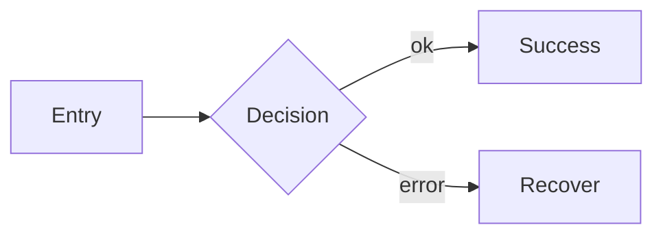

# <Product> — Design brief

## Problem & goal
<paragraph> · Success metrics: <metric>, <metric>

## Users
| Profile | Context | Top jobs | Top frustration |
|---|---|---|---|

## Constraints
Platforms · a11y target · locales · tech · brand · domain/legal rules

## Information architecture
- <section>
  - <subsection>
Navigation model: <pattern> — why: <reason>

## Flows

## Screen inventory
| Screen | Purpose | Key components | States | Priority |
|---|---|---|---|---|

## Content model
| Entity | Fields shown | Sample values |
|---|---|---|

## Design intent
1. Who/doing:
2. Hero moment & main action:
3. Baseline conventions kept:
4. Deliberate deviation + why:
5. Direction:
6. Signature (bold in one place; quiet elsewhere):
